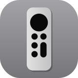
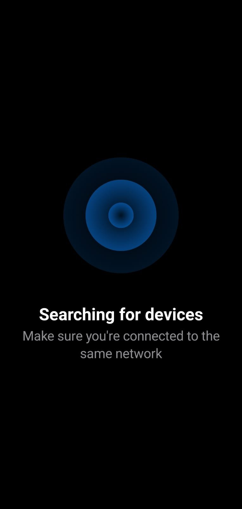
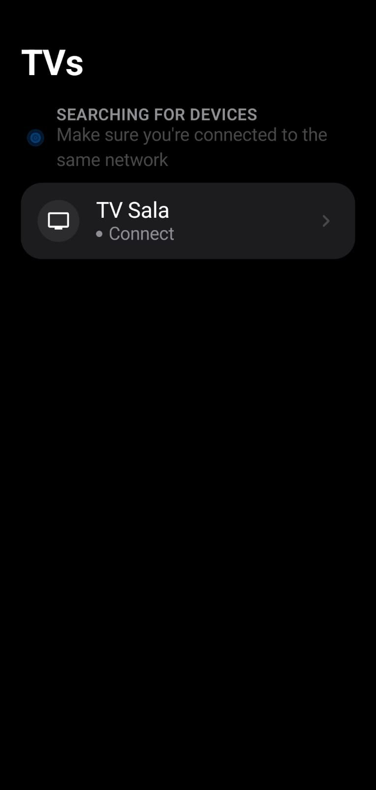
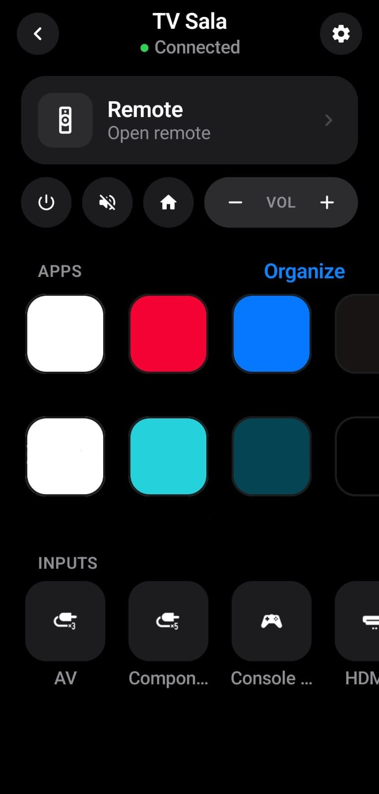
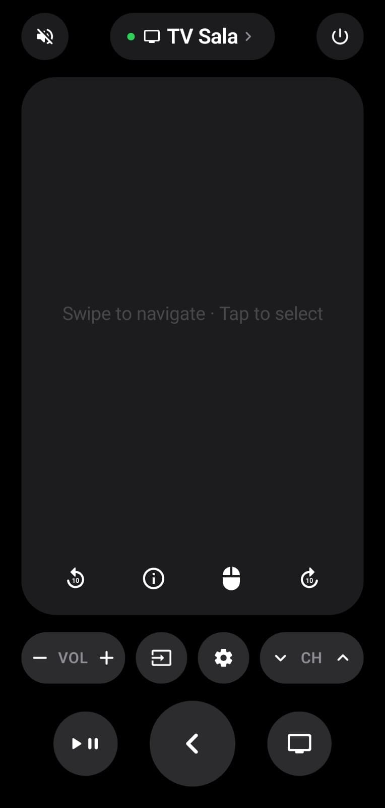
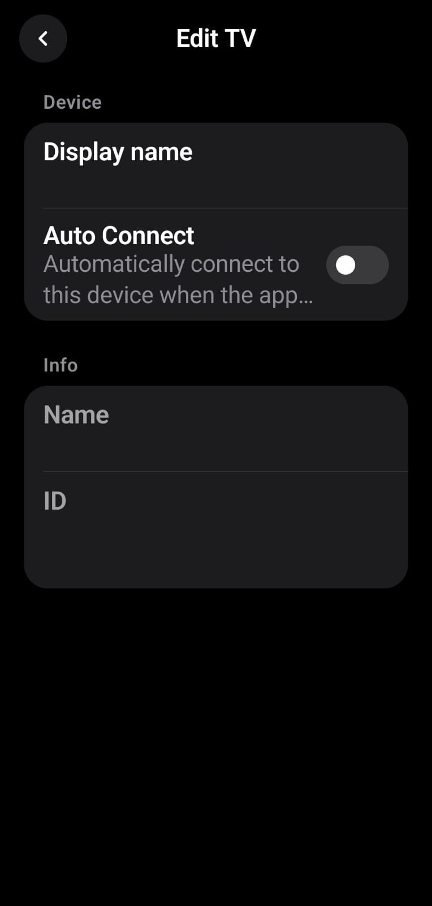

## LG Remote UI

[](https://github.com/joaosantannas/lg-remote-UI/actions/workflows/build-apk.yml)
[](https://github.com/joaosantannas/lg-remote-UI/commits/main)
[](https://github.com/heroslender/lg-remote)

Controle remoto Android, sem anúncios, para TVs LG com webOS, com um visual escuro e
minimalista feito para ser usado com uma mão só.

Este projeto é um fork do **[LG TV Controller](https://github.com/heroslender/lg-remote)**,
de [heroslender](https://github.com/heroslender). Veja os [créditos](#créditos).

### Conteúdo

* [Telas](#telas)
* [Novidades deste fork](#novidades-deste-fork)
* [Como instalar](#como-instalar)
* [Como compilar](#como-compilar)
* [Créditos](#créditos)

### Telas

<table>
  <tr>
    <th>Procurando TVs</th>
    <th>Lista de TVs</th>
    <th>Tela inicial</th>
  </tr>
  <tr>
    <td></td>
    <td></td>
    <td></td>
  </tr>
  <tr>
    <th>Controle remoto</th>
    <th>Configurações da TV</th>
    <th></th>
  </tr>
  <tr>
    <td></td>
    <td></td>
    <td></td>
  </tr>
</table>

### Novidades deste fork

* **Visual novo em todas as telas:** fundo preto, cartões arredondados, tipografia em
  destaque e indicador verde de conexão.
* **Controle com touchpad:** deslize para navegar e toque para selecionar. Há também um
  modo ponteiro, que move o cursor da TV como um mouse.
* **Botões de mídia:** voltar e avançar 10 segundos, play/pause e informações.
* **Teclas de volume do celular** controlam o volume da TV.
* **Botão de atalho para um app:** o botão 📺 e o botão Home da tela inicial abrem o app
  "TV Sala" da TV. Segurando o botão, ele vai para o Home normal da TV.
* **Apps em duas fileiras** na tela inicial.
* **Organizar apps:** escolha a ordem e esconda os apps que você não usa. A organização é
  salva separadamente para cada TV.
* **Novo ícone.**

### Como instalar

1. Abra a aba [Actions](https://github.com/joaosantannas/lg-remote-UI/actions/workflows/build-apk.yml)
   e entre na execução mais recente com ✅.
2. Em **Artifacts**, baixe o **lg-remote-ui** (é preciso estar logado no GitHub).
3. Extraia o zip e abra o `app-debug.apk` no celular, permitindo a instalação de fontes
   desconhecidas quando o Android pedir.
4. Com o celular na mesma rede Wi-Fi da TV, abra o app, escolha a TV e aceite o pedido de
   conexão que aparece na tela da TV.

O app usa o identificador `com.joaosantannas.lgremote`, então pode ser instalado junto com
o app original sem conflito.

### Como compilar

Requer JDK 17. Na raiz do projeto:

```bash
./gradlew assembleDebug
```

O APK fica em `app/build/outputs/apk/debug/`. A cada push na branch `main`, o GitHub
Actions compila o APK automaticamente.

### Créditos

* App original: **[LG TV Controller](https://github.com/heroslender/lg-remote)**, criado por
  **[heroslender](https://github.com/heroslender)**. A base do app (conexão com a TV,
  descoberta de dispositivos, armazenamento e navegação) é trabalho dele.
* Alterações deste fork: **[João Santanna](https://github.com/joaosantannas)**.
* Comunicação com a TV: [Connect-SDK](https://github.com/ConnectSDK/Connect-SDK-Android)
  (Apache License 2.0).

A lista completa de bibliotecas e licenças está em [NOTICE.md](NOTICE.md).

### Licença e avisos

O repositório original não declara uma licença, portanto os direitos sobre o código
original continuam com o autor. Este fork é mantido para uso pessoal e estudo. Para
redistribuir o app, é necessária a autorização do autor original.

Este projeto não tem ligação, patrocínio ou aprovação da LG Electronics. "LG" e "webOS"
são marcas de seus respectivos donos e são citadas apenas para indicar com quais TVs o app
funciona.
